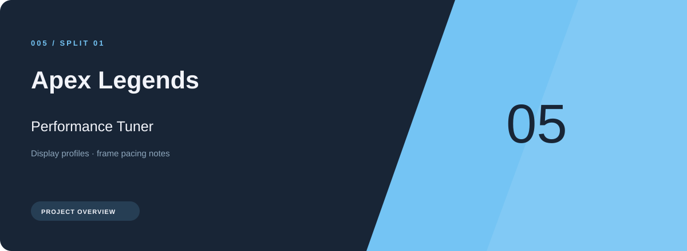
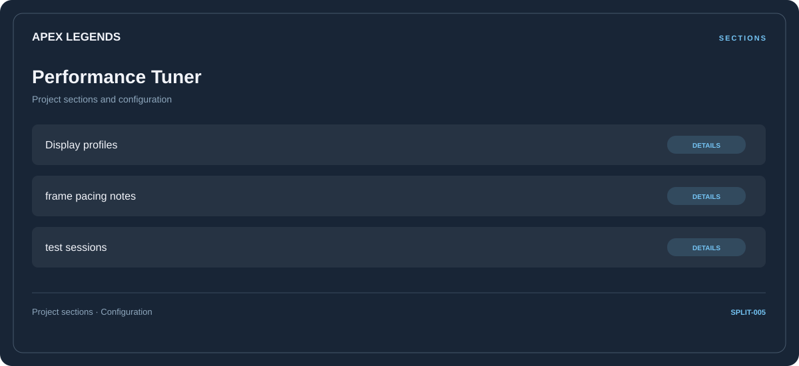

# 🎮 Apex Legends Performance Tuner

**Display profiles · Frame pacing notes · Test sessions**

## ⚡ Features

Apex Legends Performance Tuner brings display profiles and frame pacing notes into one section-based interface. Test sessions provides the third part of the workflow.

### ⚙️ Display profiles

Related settings collected into named groups for a clearer configuration workflow.

### 🧩 Frame pacing notes

Display or performance-related options, with space for configuration and comparison information.

### ⌨️ Test sessions

Session and activity information grouped by the task or context it belongs to.

## 🖥️ Project navigation

## 📥 Download

The button and cover open the project's download page. Use the information supplied with the downloaded package for installation and release-specific requirements.

## 📚 Project documentation

- [Feature reference](docs/FEATURES.md)
- [Download information](docs/DOWNLOAD.md)
- [Project page](index.html)

---

Apex Legends Performance Tuner · Program documentation and download information.
